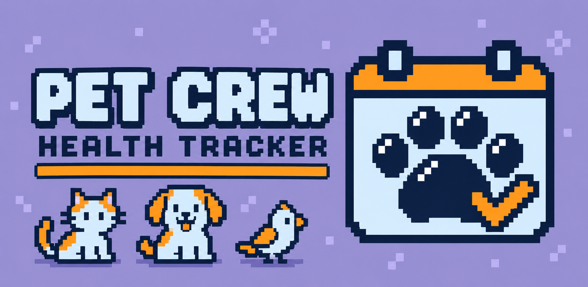
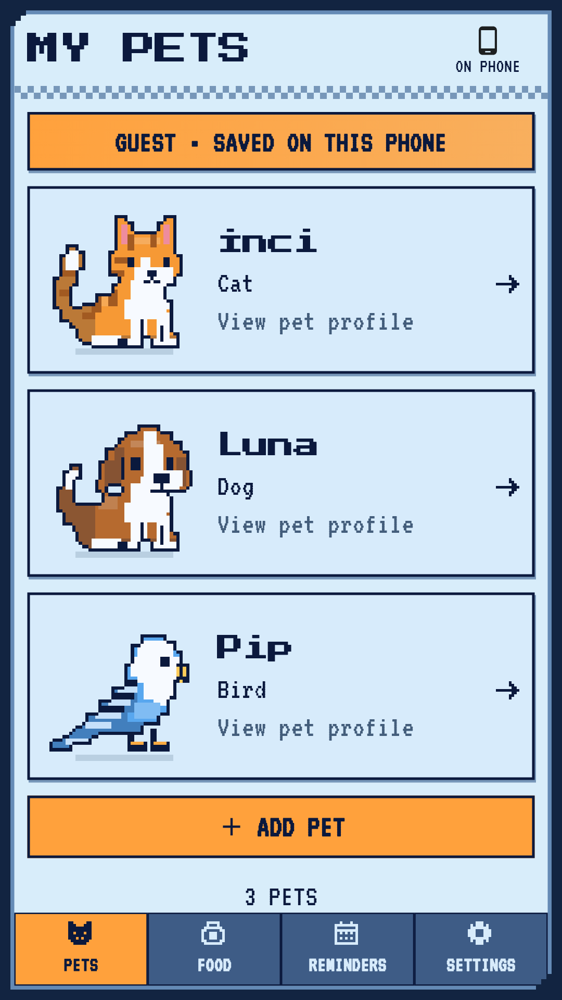
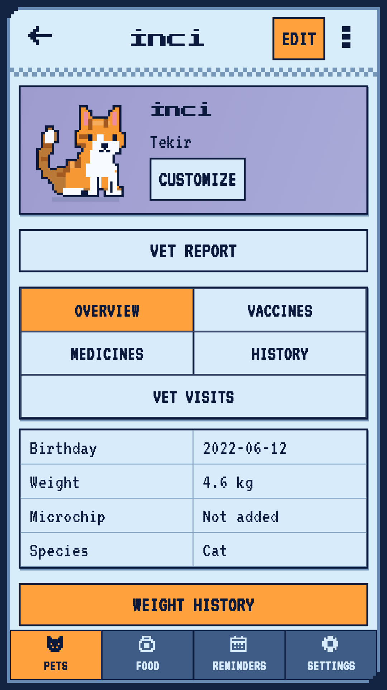
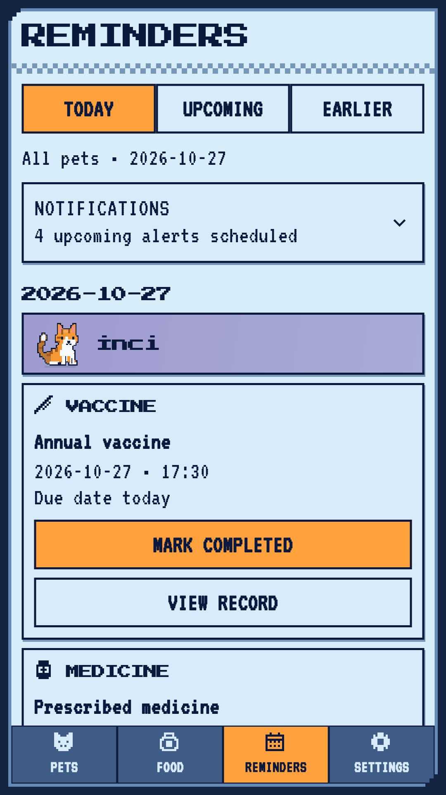
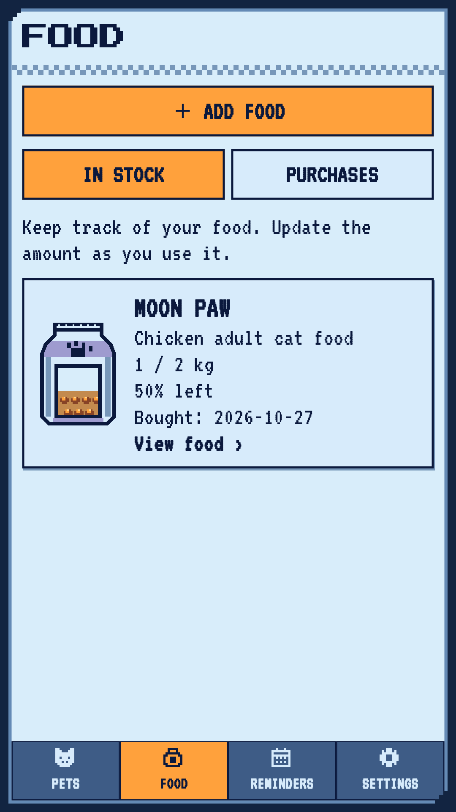

# Pet Crew — Portfolio Showcase

**A retro pixel-style Android app for everyday pet care.** Profiles, health records, reminders, food inventory and weight history, together in one offline app.

**Flutter · Dart · Riverpod · Drift / SQLite · Kotlin**

This repository presents the product, design decisions and selected implementation excerpts. The complete application source remains private. It is a documentation showcase, so it does not contain a runnable app, installation package or build instructions.

## The app

Pet Crew helps owners care for multiple cats, dogs and birds without requiring an account. Its handheld-game visual style uses pixel animals, bold frames, cool blues, lavender and orange, with consistent custom date and time pickers.

| Pets home | Pet profile | Reminders | Food inventory |
| :---: | :---: | :---: | :---: |
|  |  |  |  |

Screenshots show implemented Flutter screens with fictional sample records. [View English and Turkish screenshots →](docs/screenshots.md)

## Features implemented

- **Multiple pet profiles:** important details and customizable pixel avatars for cats, dogs and birds.
- **Care records:** vaccines, medicines, treatments, past vet visit notes and upcoming appointments.
- **Reminders and history:** combined schedules, pet-specific notifications, flexible recurrence, snoozing and completed/given/skipped records.
- **Food inventory:** brands, purchases, remaining stock and a pixel container that reflects how much is left.
- **Weight history:** dated measurements and charts with selectable time periods.
- **Vet reports:** selectable records exported as a PDF for each pet.
- **Backup and restore:** local file exports without an account.
- **English and Turkish:** device-language defaults and a manual language choice.

The current version has no account sign-in, cloud synchronization, ads or paid cosmetics. Broader animal customization and optional cloud backup are possible future improvements. Pet Crew records care information; it does not diagnose conditions or prescribe treatment.

## Engineering highlights

| Example | What it demonstrates |
| --- | --- |
| [Food tracking and pixel visualization](docs/code/food-tracking.md) | Exact stock quantities, localized decimal input and data-driven canvas drawing. |
| [Custom calendar](docs/code/pixel-calendar.md) | A reusable dialog contract, cancellation behavior and consistent date selection. |
| [Recurring reminders](docs/code/recurring-reminders.md) | Calendar-based recurrence and shorter-month handling in native Android code. |

The snippets are small excerpts from the implemented project. Supporting code is deliberately omitted; they are for reading, not a standalone app or SDK.

[Read the architecture and engineering case study →](docs/engineering.md)

## My role and development process

**Project owner and product direction: Melis Gedik.** I defined the app's requirements and visual direction, reviewed iterations and tested the experience on devices. Development was assisted by AI coding tools.

The project grew through incremental features and feedback: custom date/time pickers replaced awkward manual input, notification navigation was corrected, and food tracking controls were simplified. Data integrity and useful everyday care flows shaped the implementation alongside the visual design.

## Validation

The private source snapshot used to prepare this showcase passed Flutter static analysis and **151 automated tests**, with 11 optional visual capture tests skipped. This is a recorded validation result for that snapshot; this documentation repository does not run or build the full application.

## Contact and usage

Support: **petcrewapp@gmail.com** · [Privacy policy](https://melisgedik.github.io/petcrew-privacy/privacy-en.html) · [Türkçe gizlilik politikası](https://melisgedik.github.io/petcrew-privacy/privacy-tr.html)

This material is published for portfolio review. No open-source license is granted for the original code excerpts, documentation or artwork. Public visibility does not grant general reuse or redistribution permission. Third-party materials retain their respective rights.
