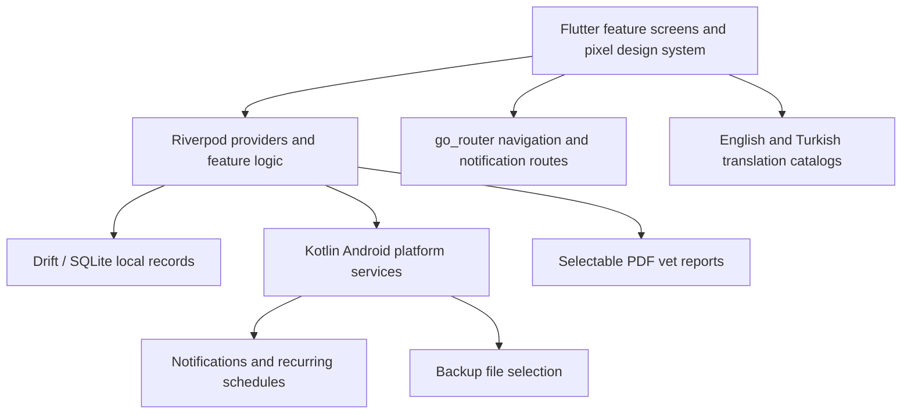

# Engineering case study

[Back to the showcase](../README.md)

## Product constraints

Pet Crew is intended for everyday pet owners who need records and reminders for several animals. The current application works locally without an account. Optional cloud services were deferred so the initial care flows could work independently of registration or a network connection.

The pixel style also had to support actual forms, translated text and accessibility settings. Shared panels, controls, calendars and time pickers keep the visual language consistent across those flows.

## Architecture of the private application

Screens present records through feature logic and repositories. Drift provides structured local storage and migrations. Native Kotlin code handles Android-specific notification scheduling and document access. Navigation connects notification taps to the relevant record, including cold starts.

This diagram describes the complete app; those implementation layers are not distributed in this showcase.

## Selected decisions and tradeoffs

| Area | Decision | Benefit and limit |
| --- | --- | --- |
| Storage | Local SQLite records with versioned migrations | Persistent offline access; no automatic multi-device synchronization. |
| Backup | Validated file restore in a database transaction | Recovery without an account; restore replaces current records and exported files must be kept private. |
| Notifications | Native schedule handling and record-specific routes | Pet-specific alerts and direct navigation; delivery still depends on device permissions and restrictions. |
| Food stock | Integer milligrams plus a visual fill fraction | Exact supported quantities and a readable stock display; owners must log changes themselves. |
| Localization | Shared English/Turkish catalogs and user language choice | Consistent translated UI and messages; additional languages still need translation and review. |
| Forms | Shared pixel calendar and time picker | Consistent interaction without typing separators; custom controls need accessibility and layout checks. |

## Three implementation examples

1. [Food tracking](code/food-tracking.md): parsing supported decimal quantities without floating-point subtraction, and mapping stock to a pixel window.
2. [Pixel calendar](code/pixel-calendar.md): a dialog entry point that separates a draft choice from a confirmed value.
3. [Recurring reminders](code/recurring-reminders.md): day/week alignment and monthly recurrence anchored to the original calendar day.

Each example identifies its original source file and explains the omitted context. None includes credentials or real users' records.

## Testing approach

The private app includes unit and widget tests for record validation, local repositories, backups, recurring care, history, localization, navigation and forms. Native tests cover Android care messages and recurrence behavior. Device checks were used during development for platform interactions such as notification taps.

The public-source preparation snapshot passed static analysis and 151 Flutter tests; 11 optional visual capture tests were skipped. This is not a claim that every Android version, device restriction or accessibility configuration has been covered.

## Scope intentionally kept private

The full source tree, build configuration, platform project, generated database code, test fixtures and installation packages are not included here. Neither are signing keys, local configuration, user backups, databases, tester lists or console captures. The screenshots use fictional demonstration records.
